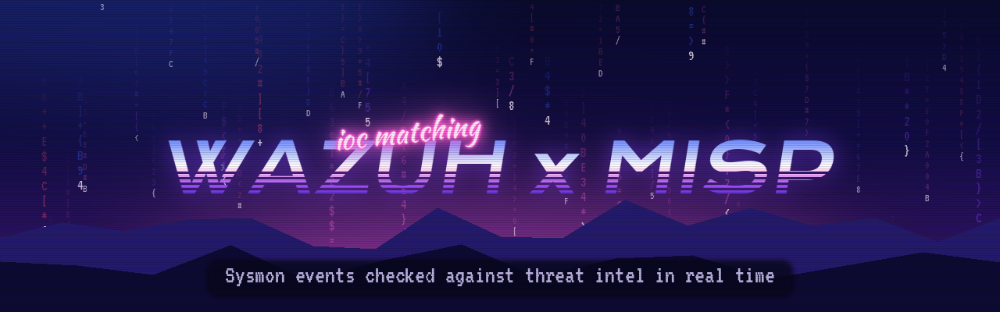
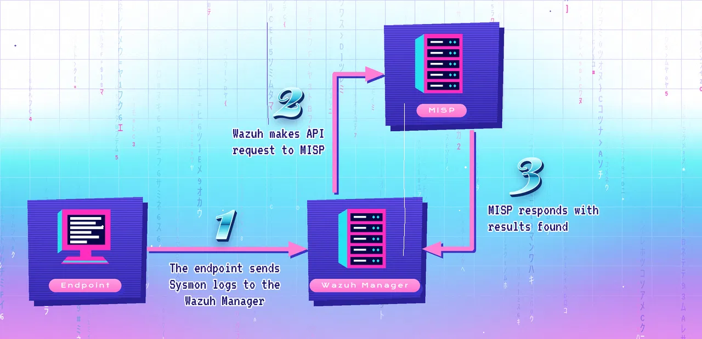

<p align="center"></p>

# Wazuh × MISP: real-time IOC matching

Every time an endpoint starts a process, loads a DLL, opens a network connection or resolves a domain, Sysmon logs it and Wazuh receives the event. This integration takes the indicator out of that event (file hash, destination IP or domain), asks **MISP** whether it's known-bad, and on a match raises a **level-12 Wazuh alert** with the MISP event attached.

The analyst gets "IoC found in threat intel" with full context, instead of copying hashes into MISP by hand.

<p align="center"></p>

## What gets checked

| Sysmon event / Wazuh source | Indicator looked up |
| --- | --- |
| 1: process creation | SHA-256 of the executable |
| 3: network connection | destination IP (public addresses only) |
| 6: driver loaded, 7: image loaded | SHA-256 of the driver / DLL |
| 15: file stream created | SHA-256 |
| 22: DNS query | queried domain |
| 23 / 24 / 25 | SHA-256 |
| Wazuh FIM (`syscheck`) | SHA-256 of the new or changed file |

Private, loopback and link-local IPs are never sent to MISP. Only attributes flagged `to_ids` count as hits, which keeps context-only data from raising alerts.

## Install (Wazuh 4.x manager)

```bash
# 1. the integration script
sudo cp integrations/custom-misp.py /var/ossec/integrations/
sudo chown root:wazuh /var/ossec/integrations/custom-misp.py
sudo chmod 750 /var/ossec/integrations/custom-misp.py

# 2. the alert rules
sudo cp rules/misp_rules.xml /var/ossec/etc/rules/
```

3. Add the block from [`ossec-integration.conf`](ossec-integration.conf) to `/var/ossec/etc/ossec.conf`. Set `<hook_url>` to your MISP URL and `<api_key>` to a MISP API key that has read access. The key lives in Wazuh's config, not in the script.
4. Restart the manager: `sudo systemctl restart wazuh-manager`.

**Lab MISP with a self-signed certificate?** Put `{"verify_tls": false}` in `/var/ossec/integrations/custom-misp.json`. Don't do this in production; install your CA instead.

**Test it:** add a test domain to a MISP event as a `domain` attribute with *IDS* checked, then `nslookup` that domain from a Windows endpoint running Sysmon. Within seconds, rule **100622** fires in the Wazuh dashboard.

## Rules

| ID | Level | Fires when |
| --- | --- | --- |
| 100620 | 3 | any event written back by the integration |
| 100621 | 5 | MISP couldn't be reached (bad key, TLS, timeout) |
| 100622 | 12 | an indicator matched a MISP attribute |

## How this differs from the common community script

I deployed this integration in a production SOC, starting from the widely shared [OpenSecure write-up](https://opensecure.medium.com/wazuh-and-misp-integration-242dfa2f2e19). This repo is a clean rewrite that fixes the problems I hit:

- **Secrets:** the MISP URL and API key come from `ossec.conf`, not hard-coded in the script.
- **TLS:** verification is **on** by default, instead of `verify=False` everywhere.
- **Hits were missed:** the original only tagged *errors* with `integration: misp`, so the parent rule never matched real hits. Every event is tagged now, and the hit and error rules hang off one parent rule.
- **Crashes:** IPv6 destinations crashed the script (`alert_output` was used before it existed), and missing fields raised errors the original didn't catch. Both are handled.
- **Robustness:**
  - It queries MISP with a JSON `POST` to `restSearch` instead of the old path-style URL.
  - Requests have a timeout, so a slow MISP can't hang the integrator.
  - It finds the Sysmon event group by name instead of assuming it's the third entry in the rule's group list.

## Testing

`tests/test_custom_misp.py` runs the script against a fake MISP API and a fake Wazuh queue socket, with no Wazuh or MISP needed. It covers domain, hash, IP and FIM hits, clean lookups, private-IP skipping, IPv6, missing fields, and a wrong API key.

## License

[MIT](LICENSE)
